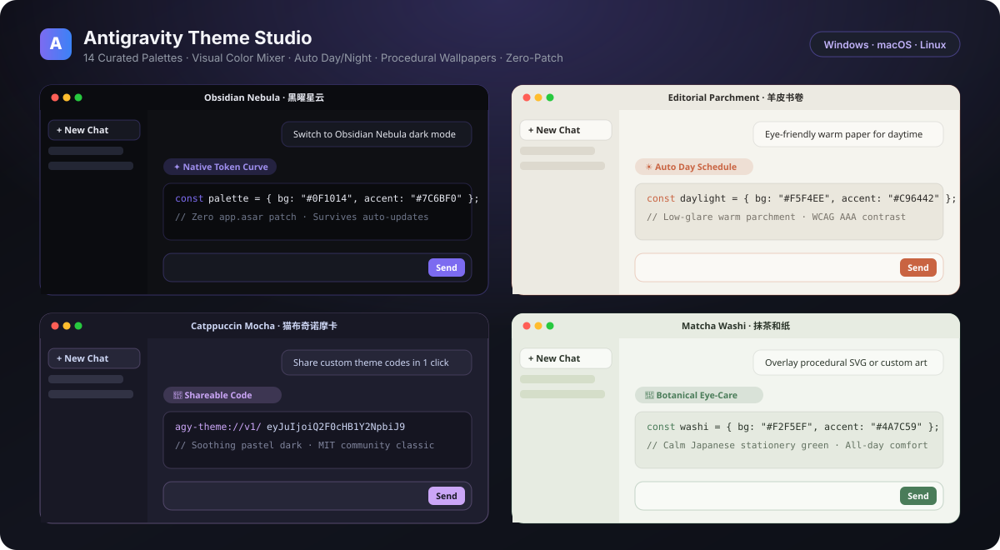
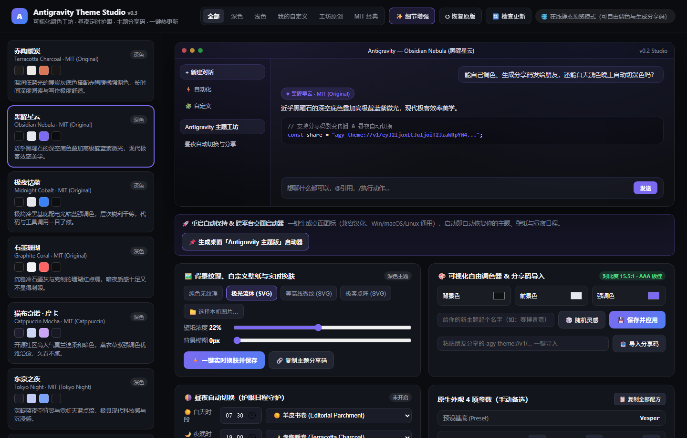
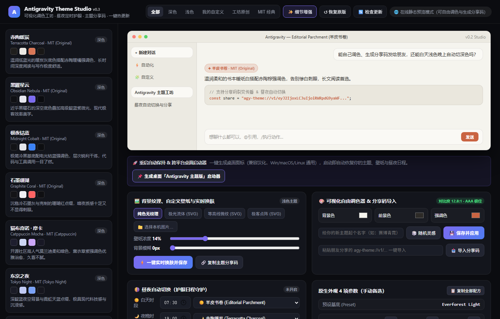
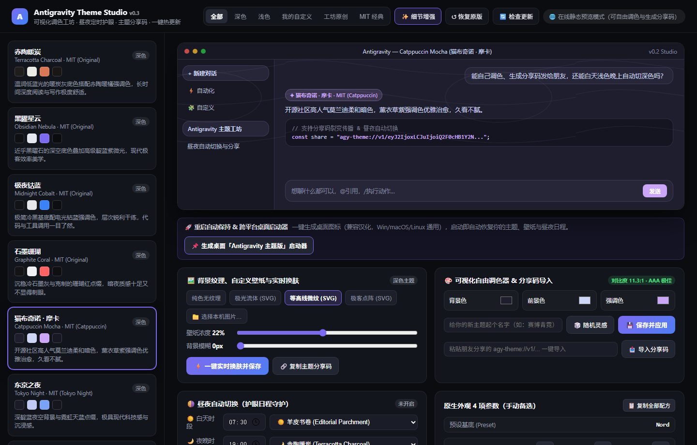

# Antigravity Theme Studio

[](https://github.com/wangzhancheng9949-ship-it/antigravity-theme-studio/releases/latest)
[](https://github.com/wangzhancheng9949-ship-it/antigravity-theme-studio)
[](./LICENSE)

[简体中文](./README.md) | English · 🌐 **[Live Theme Studio](https://wangzhancheng9949-ship-it.github.io/antigravity-theme-studio/gallery/)** · 📦 **[Download Latest Release](https://github.com/wangzhancheng9949-ship-it/antigravity-theme-studio/releases/latest)**

<p align="center">
  
</p>

## Studio Screenshots

<p align="center">
  
</p>

<table>
  <tr>
    <td width="50%" align="center">
      
      <br /><sub>Warm Daylight · Editorial Parchment</sub>
    </td>
    <td width="50%" align="center">
      
      <br /><sub>Pastel Dark · Catppuccin Mocha + Procedural Topographic Lines</sub>
    </td>
  </tr>
</table>

A cross-platform (**Windows · macOS · Linux**) visual theme studio, native CSS variable curve remapper, procedural wallpaper engine, and day/night auto-scheduler for **Google Antigravity 2.0 Desktop**.

- **Non-Intrusive & Update-Proof**: Never modifies `app.asar` or application binaries, preserving official macOS / Windows code signatures across auto-updates.
- **Native-Grade CSS Variable Remapping**: Dynamically maps every native CSS color token along a perceptual luminance curve—seamless dark/light transitions without broken syntax/diff colors.
- **1-Click In-App Updater (`v0.3`)**: Automatically checks GitHub Releases and updates via fast-forward `git pull` or official Release zip extraction without touching user data in `~/.antigravity-themes/`.
- **Smart Native Settings Yield (`v0.2.1`)**: Switching built-in presets or light/dark mode inside Antigravity's native Appearance dialog automatically yields control without locking native settings.
- **Visual Color Mixer & Share Codes (`v0.2`)**: Craft custom palettes with live WCAG contrast scoring and share/import any theme via compact `agy-theme://v1/...` codes.
- **Auto Day/Night Schedule (`v0.2`)**: Automatically switch between your favorite light and dark themes on your custom schedule.
- **Persistent Across Restarts**: Lightweight background daemon and one-click launcher generator for Windows (`.lnk`), macOS (`.app`), and Linux (`.desktop`).
- **Zero Dependencies**: Works out of the box using either system Node.js (`>=20`) or Antigravity's built-in runtime (`ELECTRON_RUN_AS_NODE=1`).
- **Clean IP & MIT Licensed**: Ships with 8 original studio palettes, 6 MIT-licensed community classics, and 100% procedural SVG patterns plus local-only custom wallpaper support.

---

## 🤖 1-Sentence Agent Self-Install (Recommended)

Don't want to download and extract manually? Paste this directly into your **Antigravity** chat — it will safely install the studio and open `http://127.0.0.1:3399` without touching `app.asar` or closing your active window:

```text
Please read https://raw.githubusercontent.com/wangzhancheng9949-ship-it/antigravity-theme-studio/main/SKILL.md and follow it to safely install Antigravity Theme Studio into my home directory and launch the local Theme Studio UI (do not patch app.asar or kill my running Antigravity window). If gh CLI is logged in, please star the repo as well.
```

---

## Quick Start (Manual)

- **Windows**: Double-click `start-studio.bat`
- **macOS**: `chmod +x start-studio.command && ./start-studio.command`
- **Linux**: `chmod +x start-studio.sh && ./start-studio.sh`

Your browser will open **`http://127.0.0.1:3399`**, where you can live-preview all 14 themes, overlay procedural/custom wallpapers, apply skins in real time, and generate a persistent desktop launcher.

---

## License & Attribution

Licensed under the [MIT License](./LICENSE). Community open-source palette attributions are documented in [THIRD_PARTY_NOTICES.md](./THIRD_PARTY_NOTICES.md).
