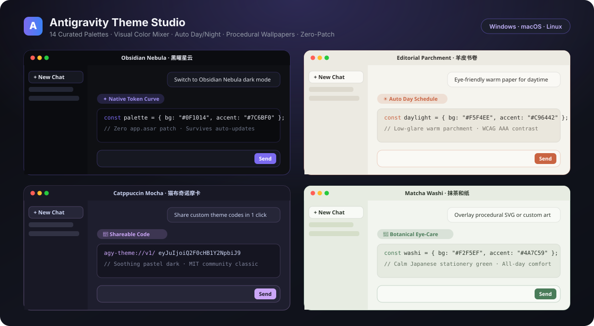
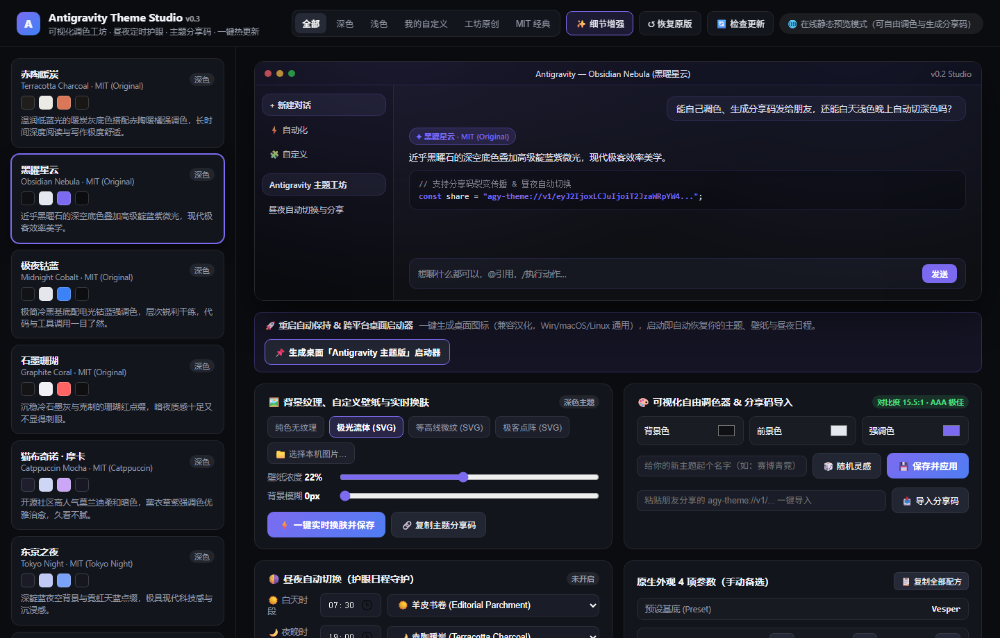
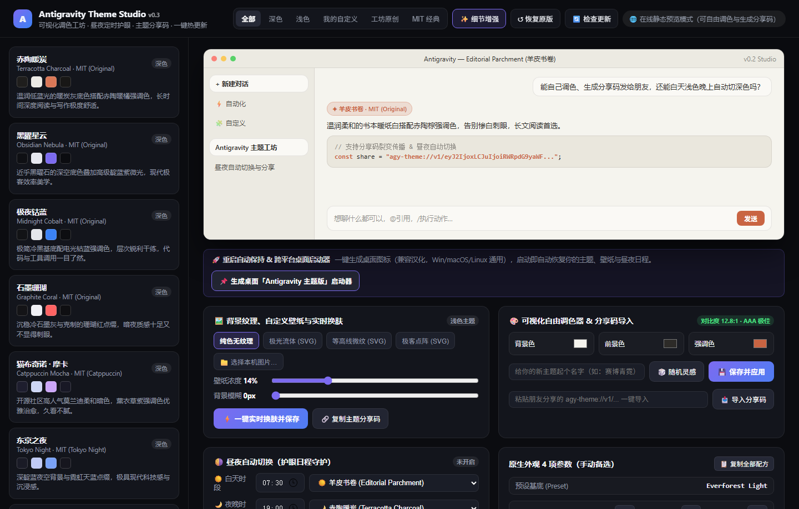
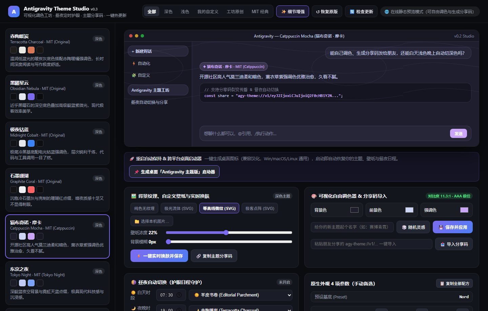

# Antigravity Theme Studio

[](https://github.com/wangzhancheng9949-ship-it/antigravity-theme-studio/actions/workflows/ci.yml)
[](https://github.com/wangzhancheng9949-ship-it/antigravity-theme-studio/releases/latest)
[](https://github.com/wangzhancheng9949-ship-it/antigravity-theme-studio)
[](./LICENSE)

简体中文 | [English](./README.en.md) · 🌐 **[在线预览与调色画廊 (Live Studio)](https://wangzhancheng9949-ship-it.github.io/antigravity-theme-studio/gallery/)** · 📦 **[下载最新免安装版 (Releases)](https://github.com/wangzhancheng9949-ship-it/antigravity-theme-studio/releases/latest)**

<p align="center">
  
</p>

## 实机工坊截图

<p align="center">
  
</p>

<table>
  <tr>
    <td width="50%" align="center">
      
      <br /><sub>护眼浅色 · 羊皮书卷 (Editorial Parchment)</sub>
    </td>
    <td width="50%" align="center">
      
      <br /><sub>莫兰迪暗色 · 猫布奇诺 + 等高线纹理 (Catppuccin Mocha)</sub>
    </td>
  </tr>
</table>

为 **Google Antigravity 2.0 桌面端** 打造的跨平台（Windows · macOS · Linux）可视化主题工坊、原生色阶重映射引擎与程序化纹理壁纸工具。

- **零侵入、不怕自动更新**：完全不修改 `app.asar` 与安装目录，不破坏 macOS / Windows 官方代码签名；客户端版本更新后依然无缝生效。
- **原生级 CSS 变量重映射引擎**：自动扫描并按明度曲线重映射页面全部原生 CSS 颜色变量，深色与浅色无缝翻转，绝无“白底白字”或局部色块割裂，完整保留语法高亮与 Diff 状态色。
- **重启自动保持 + 汉化无缝联动**：内置轻量持久化守护与跨平台启动器生成，自动兼容 `Antigravity-Hans` 等 CDP 工具，下次打开软件自动套用上次保存的皮肤与壁纸。
- **零外部依赖、三端开箱即用**：无需安装 Node.js 或 `npm install`，自动复用本机 Node 或 Antigravity 内置运行时。
- **100% 版权与商标合规**：内置 8 套原创美学色板 + 6 套 MIT 协议社区经典色板，搭配 3 款纯代码程序化生成 SVG 纹理与本地壁纸叠加（仅存本机，不上传）。

---

## 🤖 最省心用法：一句话让 Antigravity 自己帮你装（推荐）

不想自己下载解压？直接复制下方指令发给你的 **Antigravity**，它会自动安全下载到用户目录并为你打开可视化主题工坊（**全程不修改 `app.asar`、不破坏签名、不重启当前会话**）：

```text
请读取 https://raw.githubusercontent.com/wangzhancheng9949-ship-it/antigravity-theme-studio/main/SKILL.md 并按里面的步骤帮我安全安装 Antigravity Theme Studio，下载到我的用户文档目录后启动本地主题工坊网页（不要修改官方安装包，也不要强关我当前的 Antigravity）；如果我本机已登录 gh CLI，请顺便帮该仓库点个 Star 支持一下。
```

> *提示：如果不希望自动点 Star，复制时删掉最后一小句即可。本仓库同时遵循标准 **Agent Skill** 规范提供 [`skills/antigravity-theme-studio/SKILL.md`](./skills/antigravity-theme-studio/SKILL.md) 技能清单，可被 Antigravity / Claude Code / Codex 直接识别安装。*

---

## 快速开始（手动下载 · Windows / macOS / Linux）

### Windows
双击运行根目录的 **`打开主题工坊.bat`**（或 `start-studio.bat`），浏览器将自动打开 `http://127.0.0.1:3399`。

### macOS
首次赋予执行权限后双击 **`start-studio.command`**（或在终端运行）：
```bash
chmod +x start-studio.command
./start-studio.command
```

### Linux
```bash
chmod +x start-studio.sh
./start-studio.sh
```

---

## 三步完成换肤与「重启不掉皮肤」

1. **预览与选款**：在 `http://127.0.0.1:3399` 左侧点选任意深色/浅色主题，可自由叠加 **极光流体 / 等高线微纹 / 极客点阵** 或上传**本机图片壁纸**，拖动滑块调节浓度与高斯模糊。
2. **一键生效**：点击 **`⚡ 一键实时换肤并保存`**，当前运行的 Antigravity 窗口立即变身（若未通过调试模式启动，请先执行第 3 步）。
3. **跨平台自动保持**：点击页面横幅上的 **`📌 生成桌面「Antigravity 主题版」启动器`**：
   - **Windows**：在桌面生成 `Antigravity 主题版.lnk`（若本机已装 `Antigravity-Hans` 汉化，双击会自动同时拉起汉化与主题守护）。
   - **macOS**：在 `~/Applications/` 生成 `Antigravity Themed.app`。
   - **Linux**：在 `~/.local/share/applications/` 生成桌面应用入口。

---

## 内置 24 套精选主题（全部通过 WCAG AA/AAA 对比度校验）

### 深色主题（14 套）
| ID | 名称 | 中文名 | 授权来源 | 背景色 | 前景色 | 强调色 |
| :--- | :--- | :--- | :--- | :--- | :--- | :--- |
| `terracotta-charcoal` | Terracotta Charcoal | 赤陶暖炭 | MIT (Original) | `#1F1E1D` | `#ECEAE4` | `#D97757` |
| `obsidian-nebula` | Obsidian Nebula | 黑曜星云 | MIT (Original) | `#0F1014` | `#E6E8F0` | `#7C6BF0` |
| `midnight-cobalt` | Midnight Cobalt | 极夜钴蓝 | MIT (Original) | `#121316` | `#E4E6EB` | `#3B82F6` |
| `graphite-coral` | Graphite Coral | 石墨珊瑚 | MIT (Original) | `#141417` | `#F0F0F5` | `#FF6363` |
| `emerald-matrix` | Emerald Matrix | 翡翠矩阵 | MIT (Original) | `#0D1311` | `#D8ECE3` | `#10B981` |
| `oled-pitch-amber` | OLED Pitch Amber | 纯黑流金 · OLED | MIT (Original) | `#050506` | `#E6E6E8` | `#F59E0B` |
| `catppuccin-mocha` | Catppuccin Mocha | 猫布奇诺 · 摩卡 | MIT (Catppuccin) | `#1E1E2E` | `#CDD6F4` | `#CBA6F7` |
| `tokyo-night` | Tokyo Night | 东京之夜 | MIT (Tokyo Night) | `#1A1B26` | `#C0CAF5` | `#7AA2F7` |
| `dracula-velvet` | Dracula Velvet | 德古拉 · 丝绒暗紫 | MIT (Dracula) | `#282A36` | `#F8F8F2` | `#BD93F9` |
| `gruvbox-espresso` | Gruvbox Espresso | 复古浓缩 · 暖褐 | MIT (Gruvbox) | `#1D2021` | `#EBDBB2` | `#FE8019` |
| `ayu-mirage` | Ayu Mirage | 蜃景深海 · 暖金 | MIT (Ayu) | `#1F2430` | `#CCCAC2` | `#FFCC66` |
| `nordic-frost` | Nordic Frost | 极地冰川 · 霜青 | MIT (Nord) | `#2E3440` | `#ECEFF4` | `#88C0D0` |
| `rose-pine` | Rosé Pine | 玫瑰松 · 暗夜 | MIT (Rosé Pine) | `#191724` | `#E0DEF4` | `#EBBCBA` |
| `kanagawa-wave` | Kanagawa Wave | 神奈川海浪 | MIT (Kanagawa) | `#1F1F28` | `#DCD7BA` | `#7E9CD8` |

### 浅色主题（10 套）
| ID | 名称 | 中文名 | 授权来源 | 背景色 | 前景色 | 强调色 |
| :--- | :--- | :--- | :--- | :--- | :--- | :--- |
| `editorial-parchment` | Editorial Parchment | 羊皮书卷 | MIT (Original) | `#F5F4EE` | `#2D2B28` | `#C96442` |
| `ivory-studio` | Ivory Studio | 象牙简白 | MIT (Original) | `#FBFBFA` | `#37352F` | `#2383E2` |
| `silver-frost` | Silver Frost | 极简霜白 | MIT (Original) | `#F5F5F7` | `#1D1D1F` | `#0071E3` |
| `matcha-washi` | Matcha Washi | 抹茶和纸 | MIT (Original) | `#F2F5EF` | `#2C362B` | `#4A7C59` |
| `sakura-mist` | Sakura Mist | 樱吹雪 · 薄雾粉白 | MIT (Original) | `#FDF8F9` | `#382C32` | `#D95B82` |
| `solarized-daylight` | Solarized Daylight | 日光羊皮 · 经典青 | MIT (Solarized) | `#FDF6E3` | `#475B62` | `#268BD2` |
| `nord-snow` | Nord Snowstorm | 北欧雪原 · 极昼 | MIT (Nord) | `#ECEFF4` | `#2E3440` | `#5E81AC` |
| `gruvbox-sand` | Gruvbox Sand | 暖沙旧书 · 琥珀纸 | MIT (Gruvbox) | `#FBF1C7` | `#3C3836` | `#B57614` |
| `catppuccin-latte` | Catppuccin Latte | 猫布奇诺 · 拿铁 | MIT (Catppuccin) | `#EFF1F5` | `#4C4F69` | `#8839EF` |
| `rose-pine-dawn` | Rosé Pine Dawn | 玫瑰松 · 晨曦 | MIT (Rosé Pine) | `#FAF4ED` | `#575279` | `#D7827E` |

---

## v0.2 – v0.3 新增核心能力

- **🔄 一键在线检查更新与无损热更新 (`v0.3`)**：工坊右上角自动检测 GitHub 新版本；`git` 用户自动 fast-forward 拉取，`.zip` 免安装用户自动下载最新 Release 覆盖更新并自动重启后台守护，个人主题、壁纸与昼夜日程（独立存于 `~/.antigravity-themes/`）100% 零丢失。
- **🤝 原生「设置 → 外观」自动礼让 (`v0.2.1`)**：在 Antigravity 自带外观面板切换深浅模式、官方预设或颜色时，工坊覆盖层 0 延迟自动退让，绝不锁死原生设置（调字体/字号/对话宽度不误退）。
- **🎨 可视化自由调色器 + 实时对比度检测**：无需设计基础，拖动 3 个取色器（或点「随机灵感」）即可自动派生侧栏、卡片、代码块色阶，并实时计算 WCAG AA/AAA 可读性评分。
- **🌗 昼夜定时自动切换**：自由设置白天与夜晚时段及对应主题（如白天自动用「羊皮书卷」护眼浅色，19:00 自动无感切为「赤陶暖炭」深色）。
- **🔗 一键主题分享码 (`agy-theme://`)**：任何内置或自调主题均可一键复制短分享码，朋友粘贴进工坊即可 1 秒导入同款配色。

---

## Roadmap

- [x] 原生 CSS 变量曲线重映射引擎（深浅零割裂）
- [x] 原创程序化 SVG 纹理与本地自定义图片壁纸（含浓度/模糊调节）
- [x] Windows / macOS / Linux 三端启动器与重启自动保持守护
- [x] 可视化自由调色器与实时 WCAG 对比度检测
- [x] 昼夜时段自动切换深浅主题
- [x] 社区主题一键导入/导出分享码 (`agy-theme://v1/...`)

---

## 合规与致谢

- 本项目为社区独立开源工具，与 Google LLC 无隶属或官方背书关系。
- 仓库不分发任何官方二进制或受版权保护的第三方图片素材；社区开源色板署名详见 [THIRD_PARTY_NOTICES.md](./THIRD_PARTY_NOTICES.md)。
- 开源协议：[MIT License](./LICENSE)。
